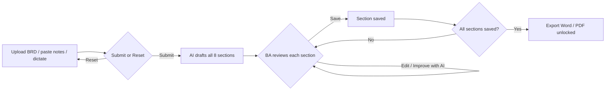

# 📘 BA Copilot

**Turn messy meeting notes or a Business Requirements Document into a client-ready Requirements & High-Level Design pack, with a Business Analyst in control at every step.**

BA Copilot is a GenAI assistant for Business Analysts in Banking & Financial Services. You paste raw notes or upload a BRD. It drafts every section of a professional requirements and design document, which you review, edit, improve and approve section by section, then export to **Word** and **PDF**.

> **AI drafts. The BA decides.** Nothing reaches the final document without human review and approval.

---

## ✨ What it produces

| # | Section | What you get |
|---|---|---|
| 1 | Requirement Analysis & Executive Summary | Objectives, scope, stakeholders, atomic requirements (REQ-xx, MoSCoW), assumptions, **open questions for the business** |
| 2 | Current Process (AS-IS) | Process steps, actors, systems, pain points linked to requirements |
| 3 | Future Process (TO-BE) | Target process with controls, AS-IS vs TO-BE comparison, business rules (BR-xx) |
| 4 | User Stories | INVEST-style stories (US-xx) with **Gherkin** acceptance criteria incl. negative scenarios |
| 5 | Data Requirements & Mapping | Source-to-target mapping (DM-xx), transformation rules, data quality rules, privacy notes |
| 6 | Test Cases & SQL Validation | UAT test cases (TC-xx) + **SQL validation queries** (reconciliation, null, duplicate, rule checks) |
| 7 | High-Level Design | Architecture components, data flow, interfaces, NFRs, security, risks (RISK-xx), phasing |
| 8 | Traceability Matrix | REQ → US → DM → TC coverage with gaps flagged |

**Diagrams** (Mermaid, editable, live preview): AS-IS & TO-BE process flows, customer journey, state chart, system sequence diagram, data flow/architecture, ER data model, or any custom diagram you describe. Each diagram can be placed in the section of your choice.

## 🧭 Workflow



- **Three ways to give input, usable together:** upload documents (.docx / .pdf / .txt / .md), paste or type notes, or **dictate** with the built-in recorder.
- **Submit / Reset:** *Submit* sends everything to the AI engine, which drafts every section in one go. *Reset* clears all inputs back to their original state.

- **Chained generation:** each section is generated from your input *plus* the sections it depends on, so IDs stay consistent (test cases are written against the user stories, the traceability matrix only uses IDs that exist).
- **Edit and preview:** Markdown editor with a rendered preview.
- **Improve with AI:** one-click *client-ready*, *fix grammar*, *concise*, *more detail*, or your own instruction ("use RBI terminology", "add a negative scenario per story").
- **Undo:** the last 10 versions of every section are kept.
- **Save each section** when you're satisfied. Optionally **Approve** to lock it. Progress is tracked in the sidebar.
- **Export gate:** Word and PDF export unlock only when **every section has been saved**, so no unreviewed AI text leaves the tool.
- **Projects:** saved automatically as JSON in `projects/`; download or import to continue later.
- **Export:** cover page, document control, section review status, table of contents, styled tables, code blocks, numbered figures, headers and page numbers.

### Dictation
The recorder works with any provider:
- **OpenAI key** → Whisper transcription (best for long, jargon-heavy dictation)
- **Gemini key** → Gemini audio transcription
- **No key / Demo / Claude** → free Google Web Speech (needs internet)

On Windows you can also press **Win + H** inside the notes box to use Windows voice typing.

## 🚀 Quick start

```bash
git clone https://github.com/raj333m/BA_Copilot.git
cd BA_Copilot
python -m venv .venv
# Windows:  .venv\Scripts\activate      Mac/Linux:  source .venv/bin/activate
pip install -r requirements.txt
streamlit run app.py
```

The app opens at http://localhost:8501.

1. Leave the provider on **Demo mode**, click **Load sample example** → **🚀 Submit to AI**, then review and **Save** each section and export. No API key needed.
2. To use your own notes, choose a provider in the sidebar and paste your API key:
   - **Google Gemini** (free tier available): key from https://aistudio.google.com/apikey
   - **OpenAI**: https://platform.openai.com/api-keys
   - **Anthropic Claude**: https://console.anthropic.com/

   Optionally set `GEMINI_API_KEY`, `OPENAI_API_KEY` or `ANTHROPIC_API_KEY` as environment variables. Keys are never written to disk.

### Diagrams in exports
Live preview uses mermaid.js in the browser. For Word/PDF, diagrams are converted to images using:
1. **Mermaid CLI** if installed (works offline): `npm install -g @mermaid-js/mermaid-cli`
2. otherwise the free **mermaid.ink** service (needs internet).

## 🏗 Project structure

```
app.py                  Streamlit UI (Input → Sections → Diagrams → Preview & Export)
core/llm.py             Provider layer (Gemini / OpenAI / Claude over HTTP, Demo mode)
core/sections.py        Section definitions, dependency chain, prompt templates
core/diagrams.py        Mermaid preview + PNG rendering for export
core/exporters.py       Markdown → Word (python-docx) and PDF (reportlab)
core/input_reader.py    Reads .docx / .pdf / .txt uploads
core/demo_content.py    Fictional UK consumer-credit example for Demo mode
samples/                Sample messy meeting notes
projects/               Saved projects (JSON)
```

## 🛡 Responsible AI & governance

- **Human-in-the-loop:** every section is reviewed, edited and explicitly approved; the document records each section's review status.
- **No invented facts:** prompts instruct the model to flag anything not in the input as **[Assumption]** or raise it as an **Open Question** rather than hallucinate system names, figures or regulation clauses.
- **Data privacy:** use synthetic, masked or public information only. Do not paste confidential client or customer data into third-party AI services unless your organisation has approved it.
- **Validate before use:** SQL and table names must be checked against real schemas; AS-IS processes need confirmation from process owners.

## 🗺 Roadmap ideas

- RAG over regulatory texts (FCA / PRA / RBI) to cite clauses in requirements
- Jira / Azure DevOps export of user stories
- Version comparison (diff) between document versions
- Team review comments per section

---

Built by **Aishwarya Raj Singh**, BFSI Regulatory & Data Business Analyst, to show how GenAI can speed up BA documentation while keeping quality, traceability and governance.
